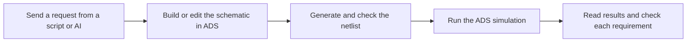

# ADS Bridge

Use scripts or AI to drive **Keysight Advanced Design System (ADS)**. For example, you can draw an RC filter, change its resistor from 3 kΩ to 6 kΩ, and ask ADS to simulate both versions. The bridge returns the two cutoff frequencies. You can run the same steps on your own circuit or open ADS to inspect the schematic and results.

[Quick start](#quick-start) · [User guide](docs/guide.md) · [中文文档](README.zh-CN.md) · [Download v2.3.5](https://github.com/Raven49963/ADS-Bridge/releases/tag/v2.3.5) · [MIT License](LICENSE)

This project draws inspiration from [Arcadia-1/virtuoso-bridge-lite](https://github.com/Arcadia-1/virtuoso-bridge-lite), which connects AI, scripts, and command-line tools to circuit design software. See [Acknowledgments](#acknowledgments).

## Quick start

You need **Windows, Python 3.11 or later, Keysight ADS 2026 Update 0.1 with the 64-bit simulator, and a valid ADS simulation license**. Run these commands in PowerShell.

```powershell
git clone https://github.com/Raven49963/ADS-Bridge.git
Set-Location ADS-Bridge
python -m venv .venv
.\.venv\Scripts\python.exe -m pip install ".[mcp]"
.\.venv\Scripts\ads-bridge.exe status
.\.venv\Scripts\python.exe -B .\verify_closed_loop.py
```

The `status` command checks whether your computer can find ADS. The last command runs the filter example with no ADS window required. Look for `rc_closed_loop` in the output to see both cutoff frequencies. If the status check cannot find ADS, follow the [installation instructions](docs/guide.md#installation).

## From design to verification



| What do you want to do? | Where to start |
| --- | --- |
| Run an existing ADS netlist | [Simulate from Python or the command line](docs/guide.md#run-an-existing-netlist) |
| Let Codex or Google Antigravity use ADS | [Connect an AI client through MCP](docs/guide.md#connect-an-ai-client) |
| See the schematic and simulation report in ADS | [Install the ADS add-on](docs/guide.md#connect-to-the-ads-window) and start in read-only mode |
| Find which parameter values meet your targets | [Check results against specifications](docs/guide.md#check-results-against-specifications) |

## Why use it?

- **Run repeatable experiments.** Use one script to change values, run several simulations, and see which values meet your targets.
- **Give AI a readable view of the circuit.** The bridge lists parts, connections, and simulation settings from the netlist. It can flag issues such as floating nodes, and you can check its results against the raw waveforms and logs.
- **Send less data to AI.** Register a netlist once and refer to it by a short ID. Send only the parameters you changed or the measurements you need. Read the full waveform when you need to investigate further.
- **Work with or without the ADS window.** Run batches in the background, or open the schematic and Data Display in ADS. For edits through the add-on, you can grant write access to the current workspace.

## Verified results

Version 2.3.5 passed 68 offline tests and an end-to-end run with the ADS simulator in the background. In the filter example, changing the resistor from 3 kΩ to 6 kΩ reduced the simulated cutoff frequency from **52.34 Hz to 26.47 Hz**. In a separate power check, an output of 1 mW correctly failed a 10 mW target whether the target was specified in watts or dBm. [Release notes](https://github.com/Raven49963/ADS-Bridge/releases/tag/v2.3.5) · [Run the checks yourself](docs/guide.md#testing-and-troubleshooting)

## Academic use

If you use ADS Bridge in a paper, please credit **qihang yuan** in the methods or acknowledgments section and state the tool name, version, what you used it for, and the repository URL.

> We used ADS Bridge by qihang yuan (version [version]) to [describe how you used it]. Source code is available at [Raven49963/ADS-Bridge](https://github.com/Raven49963/ADS-Bridge).

Project contact **qihang yuan** · [qihangyuan43@gmail.com](mailto:qihangyuan43@gmail.com)

## Acknowledgments

Thank you to the authors and contributors of [Arcadia-1/virtuoso-bridge-lite](https://github.com/Arcadia-1/virtuoso-bridge-lite). Their project connects to Cadence Virtuoso. ADS Bridge draws on its approach to providing entry points for AI, scripts, and the command line. This README also follows its example of pairing a short quick start with a full guide. [Virtuoso Bridge documentation](https://virtuoso-bridge.tokenzhang.com/)

The bridge source is available under the [MIT License](LICENSE). Obtain ADS, its simulation license, and any third-party device libraries separately. If you run into a problem, include your ADS version, the steps to reproduce it, and the error message in [GitHub Issues](https://github.com/Raven49963/ADS-Bridge/issues).
