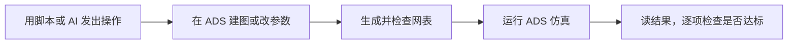

# ADS桥接工具

这个工具让你用脚本或 AI 操作 **Keysight ADS**。比如，你可以让它画一个 RC 滤波器，把电阻从 3 kΩ 改成 6 kΩ，交给 ADS 仿真，再告诉你截止频率变了多少。你可以把同一套步骤用在自己的电路上，也可以打开 ADS 查看原理图和仿真结果。

[快速开始](#快速开始) · [使用手册](docs/guide.md) · [项目优势](#项目优势) · [论文使用声明](#论文使用声明) · [下载 v2.3.5](https://github.com/Raven49963/ADS-Bridge/releases/tag/v2.3.5) · [MIT 许可证](LICENSE)

> 本项目参考 [Arcadia-1/virtuoso-bridge-lite](https://github.com/Arcadia-1/virtuoso-bridge-lite)，借鉴了用 AI、脚本和命令行操作电路设计软件的思路。[参考与致谢](#参考与致谢)

## 快速开始

准备 **Windows、Python 3.11 或更高版本、ADS 2026 Update 0.1（64 位仿真）和可用的 ADS 仿真许可证**。打开 PowerShell，逐行执行下面的命令。

```powershell
git clone https://github.com/Raven49963/ADS-Bridge.git
Set-Location ADS-Bridge
python -m venv .venv
.\.venv\Scripts\python.exe -m pip install ".[mcp]"
.\.venv\Scripts\ads-bridge.exe status
.\.venv\Scripts\python.exe -B .\verify_closed_loop.py
```

倒数第二条命令检查电脑能不能找到 ADS。最后一条跑上面的滤波器示例，不用提前打开 ADS 窗口。跑完后，在输出的 `rc_closed_loop` 一栏找两次仿真的截止频率。如果检查时找不到 ADS，按[安装说明](docs/guide.md#安装与环境检查)填入你的 ADS 安装路径。

## 从设计到验证



| 想做什么 | 从哪里开始 |
| --- | --- |
| 手上已经有一个 ADS 网表，想直接跑仿真 | [用 Python 或命令行仿真](docs/guide.md#用-python-和-cli-操作网表) |
| 想让 Codex 或 Google Antigravity 操作 ADS | [配置 MCP](docs/guide.md#接入-ai-客户端)。它让 AI 调用这个工具 |
| 想在 ADS 里看图和仿真报告 | [安装 ADS 插件](docs/guide.md#连接在线-ads)。仅查看时可以用只读模式 |
| 想比较多组参数，找出哪些达标 | [按指标验收](docs/guide.md#规格验收流程)，看每组参数的结果 |

## 项目优势

- **少做重复操作。** 同一段脚本能改参数、跑多次仿真，再逐项检查结果。比如试五个电阻值时，可以直接看出哪些值达到了要求。
- **让 AI 看懂电路。** 网表记录了用了哪些器件、器件怎么连、要跑哪种仿真。桥接会把这些信息整理出来，也能提示悬空节点等问题。要核对 AI 的结论，还可以查原始波形和仿真日志。
- **减少发给 AI 的数据。** 登记一次网表后，后续可以用简短的编号引用它，只发改动的参数。只需判断是否达标时，可以先看关键频点和指标，必要时再读完整波形。
- **按需要选操作方式。** 用 Python、命令行或 AI 都能调用同一个桥接。后台适合批量跑仿真，在 ADS 里则方便直接看图。需要让桥接改图时，可以只对当前工作区开启写权限。

## 验证记录

v2.3.5 通过了 68 项离线测试，也用真实 ADS 跑通了后台仿真。滤波器示例把电阻从 3 kΩ 改成 6 kΩ 后，截止频率从 **52.34 Hz 降到 26.47 Hz**。另一个用例检查功率是否达标。仿真结果是 1 mW，目标是 10 mW，无论目标写成 W 还是 dBm，结果都正确显示为未达标。[发行说明](https://github.com/Raven49963/ADS-Bridge/releases/tag/v2.3.5) · [自己复验](docs/guide.md#测试与排查)

## 论文使用声明

如果在论文中使用了 ADS 桥接工具，请在方法或致谢部分注明工具名称、所用版本、实际用途和仓库地址，并署名 **qihang yuan**。

> 本研究使用 qihang yuan 的 ADS 桥接工具（版本 [填写版本号]）完成[填写实际用途]。源码见 [Raven49963/ADS-Bridge](https://github.com/Raven49963/ADS-Bridge)。

项目联系人 **qihang yuan** · [qihangyuan43@gmail.com](mailto:qihangyuan43@gmail.com)

## 参考与致谢

感谢 [Arcadia-1/virtuoso-bridge-lite](https://github.com/Arcadia-1/virtuoso-bridge-lite) 的作者和贡献者。原项目连接的是 Cadence Virtuoso。ADS 桥接工具借鉴了它为 AI、脚本和命令行提供入口的思路，也参考了先用一个示例上手、再查完整手册的写法。[参考项目的使用指南](https://virtuoso-bridge.tokenzhang.com/)

桥接源码以 [MIT](LICENSE) 开源。ADS 软件、仿真许可证和第三方器件库需自行取得。遇到问题，可在 [GitHub Issues](https://github.com/Raven49963/ADS-Bridge/issues) 附上 ADS 版本、操作步骤和报错。
